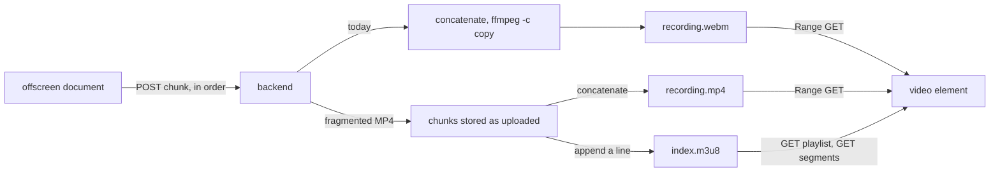

# HLS and DASH against the chunk upload: fragmented MP4 chunks could retire the remux, and native live playback does not hold (2026-11-02 10:24)

Page: https://claude.ai/artifact/EZUt3U4oyhmfj5zZDG59AN
Follows: [2026-09-13-1302-demo.md](2026-09-13-1302-demo.md), which built the upload and the remux this report compares against.

## Summary

Today the extension uploads a recording in pieces, and the backend joins them into one video file at the end, which plays and scrubs well but cannot be watched until the recording finishes.
HLS and DASH are the standard ways to stream video as many small files, and the question was whether streaming the pieces that way should replace the join.
Those standards replace only the last step, and today's pieces cannot serve as their small files, because each piece depends on the ones before it.
Two changed settings in Chrome's recorder make every piece a small playable file, measured on a test canvas in Chrome 154; the backend could then drop ffmpeg, a lost piece costs only its own two seconds, and the pieces still join into one scrubbable file.
Chrome's built-in player handled finished HLS recordings well and recordings in progress badly, so viewing during a recording needs a player library.
The recommendation is to change the chunk format when the upload path is next worked on, to add HLS only if the client wants viewing during a recording, and to skip DASH.
Nothing was measured on real tab capture in the new format, and no product code changed.

## Result by option

| Option | Finished recording in Chrome | Viewing during a recording | Backend needs ffmpeg |
| ------ | ---------------------------- | -------------------------- | -------------------- |
| Current WebM upload and remux | Plays and seeks | Impossible | Yes |
| HLS from today's chunks, through ffmpeg | Plays and seeks, with 7 s segments and a duration 1.684 s short | Not tried | Yes |
| HLS from fragmented MP4 chunks | Plays and seeks | Native player unreliable | No, given a `moof` parser, which is unbuilt |
| DASH | Needs a player library | Needs a player library | Depends on the segment format |

## HLS and DASH define one stage of the pipeline

**HLS and DASH define how a player pulls segments, so capture, the spool and the upload all stay.**
RFC 8216 says "The production of the source media is outside the scope of this document."
Pushing media to a server is the separate [DASH-IF Live Media Ingest](https://dashif.org/Ingest/) specification, whose HTTP POST or PUT to a receiver is the shape [offscreen.ts](../../src/extension/offscreen.ts#L63) already uses.
The choice is what the backend publishes after the existing upload: one finished file, or a list of segments.



## Problem: today's chunks are byte cuts of one WebM stream

**A chunk after the first cannot be a segment, because it opens neither alone nor on a keyframe.**
The measurements come from the recording `e9fa6cb0`, made in the dry run of 2026-09-13: real tab capture, a 2 s timeslice, 18 chunks, 10,163,730 bytes and 36.447 s.

- **Chunks do not open alone:** `ffprobe` on chunks 2 and 9 reports "Invalid data found when processing input", and chunks 2 to 7 of every canvas run below do the same.
- **Chunks start mid-cluster:** chunks 2 to 18 reach their first cluster ID, `1F43B675`, 8 to 29 KB after the chunk starts.
- **Keyframes ignore the timeslice:** the encoder wrote a keyframe every 101 video packets, 6.7 to 7.1 s apart at 14.7 frames per second, and no chunk after the first starts on one.
- **Stream-copy HLS inherits that spacing:** `ffmpeg -c copy -f hls -hls_time 2` wrote segments of 6.699, 6.932, 7.136, 7.149, 6.816 and 0.031 s.
- **Stream-copy HLS misstates the duration:** those durations sum to 34.763 s for a 36.447 s recording, so the playlist is 1.684 s short, and ffmpeg warned "The segment duration may not be precise".

## Solution: two MediaRecorder options make each chunk a segment

**`mimeType: 'video/mp4;codecs=vp9,opus'` and `videoKeyFrameIntervalDuration: 2000` turn the chunks into an init segment followed by fragments.**
The measurement ran on Google Chrome 154.0.8037.95, recording a canvas at 15 frames per second with an oscillator as audio, at a 2 s timeslice, for 40 s.

- **Chunk 1 is an init segment:** it holds `ftyp` and `moov`, 1,200 bytes, and no media.
- **Every later chunk starts on a keyframe:** 19 of 19 did, read by `ffprobe` on the init followed by that chunk alone.
- **Chunk length holds:** chunks last 2.04 to 2.05 s, apart from the first media chunk at 4.08 s, which holds the keyframes at 0 and 2.035 s, and the last at 1.12 s.
- **Chunks are whole boxes:** in the 13 s runs each later chunk held only `moof` and `mdat` boxes, ended on a box boundary, and decoded with the init alone.
- **Chunks play as HLS unmodified:** a plain text playlist over the chunks loaded in a native `<video>`, seeked to 15 s and played on.
- **Chunks concatenate into one seekable file:** `cat` with no ffmpeg gave a file that `<video>` reported as 39.951 s, seeked to 15 s and played to 16.965 s.

| Chunk | WebM, first video packet (s) | WebM, keyframe inside (s) | Fragmented MP4, first video packet (s) |
| ----- | ---------------------------- | ------------------------- | -------------------------------------- |
| 1 | 0.000 | 0.000 | init segment, no media |
| 2 | 1.982 | | 0.000 |
| 3 | 3.999 | | 4.080 |
| 4 | 6.065 | 6.699 | 6.124 |
| 5 | 8.099 | | 8.171 |
| 6 | 10.165 | | 10.219 |
| 7 | 12.166 | 13.631 | 12.262 |
| 8 | 14.232 | | 14.308 |
| 9 | 16.232 | | 16.352 |
| 10 | 18.265 | | 18.400 |
| 11 | 20.315 | 20.767 | 20.449 |
| 12 | 22.349 | | 22.491 |
| 13 | 24.448 | | 24.537 |
| 14 | 26.515 | 27.916 | 26.584 |
| 15 | 28.582 | | 28.633 |
| 16 | 30.582 | | 30.678 |
| 17 | 32.664 | | 32.720 |
| 18 | 34.665 | 34.732 | 34.769 |
| 19 | | | 36.813 |
| 20 | | | 38.860 |

The WebM column is the real tab recording and the fragmented MP4 column is the canvas, so the table compares structure and not content.
In the fragmented MP4 column every first video packet is a keyframe, and the only other keyframe is at 2.035 s, inside chunk 2.

**The keyframe option is what makes MP4 chunks arrive at all.**
Five option sets ran at once on one canvas for 13 s, at a 2 s timeslice and 3 Mbit/s, on Chrome 154:

| Option set | Chunks | Keyframes (s) | Later chunks decode alone |
| ---------- | ------ | ------------- | ------------------------- |
| `video/webm;codecs=vp9,opus` | 7 | 0, 6.726 | No |
| The same, keyframes at 2000 ms | 7 | 0, then every 2.04 | No |
| `video/mp4;codecs=avc1.42E01E,mp4a.40.2` | 2 | 0, 6.727 | Yes, but one chunk of 1,381,384 bytes arrived at stop |
| The same, keyframes at 2000 ms | 7 | 0, then every 2.04 | Yes |
| `video/mp4;codecs=vp9,opus`, keyframes at 2000 ms | 7 | 0, then every 2.04 | Yes |

For MP4, decoding alone means with the init prepended.
Playwright's Chromium 153.0.8010.12 matched Chrome on all three VP9 rows and spaced H.264 keyframes irregularly, 0.13 to 2.05 s apart, so the H.264 result belongs to branded Chrome.
The 2000 ms interval did not grow the WebM: 1,468,602 against 1,586,017 bytes on Chrome, and 1,460,481 against 1,616,339 on Chromium, because the bitrate target holds the size and the cost, if any, lands on picture quality, which was not measured.

## The two designs compared

| | Current upload and remux | HLS with fragmented MP4 chunks |
| - | ------------------------ | ------------------------------ |
| Viewing during a recording | Impossible until finalize | Possible, with the limits below |
| Player in Chrome | `<video>` | `<video>`, native in Chromium 153 and Chrome 154 |
| Container | WebM | Fragmented MP4; RFC 8216 says "Transport of other media file formats is not defined." |
| Finalize | Concatenate and `ffmpeg -c copy`: 0.03 s for this recording | Append `#EXT-X-ENDLIST` |
| Backend memory at finalize | The whole recording, in one buffer under the store's one mutex ([store.go](../../backend/store.go#L142)) | One chunk |
| Backend tools | ffmpeg and ffprobe | None, given a `moof` parser for durations, which is unbuilt |
| A lost chunk | The recording never finalizes ([offscreen.ts](../../src/extension/offscreen.ts#L191)) | The playlist omits that segment |
| A lost first chunk | File unreadable: "EBML header parsing failed" | Unreadable as well, though the init is 1,200 bytes |
| Stored for one hour, extrapolated | One file of 1.00 GB | 1,756 segments and a playlist, with the one file available by concatenating |
| Authorization | One URL | The playlist and every segment |
| Adaptive bitrate | None | None, since it needs a transcoder and `-c copy` avoids one |

The extrapolation for one hour:

```text
10,163,730 B x 8 / 36.447 s = 2.23 Mbit/s
2.23 Mbit/s x 3600 s / 8 = 1.00 GB
3600 s / 2.05 s = 1,756 segments
```

**Adaptive bitrate and CDN fan-out are the usual reasons to adopt these protocols, and a recording with one rendition and few viewers uses neither.**
The client's viewer count is not known.
The current design's own advantage is that one file and one URL are already tested end to end across every demo beat.

## A lost chunk costs 4.475 s today and one segment with fragmented MP4

**Removing chunk 9 from the real recording, 16.232 to 18.215 s, lost picture until the next keyframe.**

- **The remux survives:** `ffmpeg -c copy` succeeded with chunk 9 removed, and the file kept its 36.447 s duration.
- **Decoded frames fell by 62:** 537 became 475, which is the 25 packets in chunk 9 and the 37 that failed to decode afterwards.
- **The picture gap is more than twice the chunk:** 20.767 s, the next keyframe, minus 16.292 s, the last packet before the hole, is 4.475 s.
- **The file recovers at the keyframe:** a frame at 22 s matches the intact file exactly, with PSNR reported as `inf`.
- **The backend never reaches this path:** a missing chunk stops the extension posting stop, so today's recording stays unfinalized.

A VOD playlist with one fragmented MP4 segment removed, marked `#EXT-X-DISCONTINUITY`, loaded in Chrome 154 with a duration of 37.946 s against 39.951 s, seeked to 15 s and played to 16.963 s.
Playing across the hole, rather than seeking past it, was not measured.

## Problem: native live playback in Chrome 154 does not hold

**The same chunks that play well as a finished recording fail in three ways while the recording is live.**
`live.mjs` uploads each chunk as it is emitted and appends it to a playlist with `#EXT-X-TARGETDURATION:5`; native `<video>` players opened at different moments in the one recording.
"Behind" is seconds since `recorder.start()` on the page's `performance.now()`, minus `video.currentTime`.

| Opened after chunk | Media in the playlist (s) | Opened at (s) | Result | Behind while playing (s) | Ended at, of 39.951 s |
| ------------------ | ------------------------- | ------------- | ------ | ------------------------ | --------------------- |
| 2, in an earlier 36 s run | 4.07 | 4.18 | `DEMUXER_ERROR_COULD_NOT_PARSE` | | |
| 3 | 6.12 | 6.20 | `DEMUXER_ERROR_COULD_NOT_PARSE` | | |
| 6 | 12.26 | 12.39 | Played | 12.5 to 13.2 | 33.915 |
| 10 | 20.46 | 20.55 | Played | 20.6 to 21.4 | 25.740 |
| 10, with no `EXT-X-PLAYLIST-TYPE` | 20.46 | 20.55 | Played | 20.6 to 21.4 | 25.740 |

- **Opening early is fatal:** the player errored with 6.12 s of media in the playlist and played with 12.26 s, and the threshold between them was not sought.
- **Playback starts at media time 0:** the player does not join at the live edge, so it stays behind by the recording's age when it opened.
- **The end of the list truncates a player behind the edge:** when `#EXT-X-ENDLIST` arrived at about 40 s, both open players stopped within 10 s, at 33.915 and 25.740 s, short of the 39.951 s recording.

The player's media time, sampled every 5 s:

| Seconds since `recorder.start()` | Encoded to (s) | Opened after chunk 6 (s) | Opened after chunk 10 (s) |
| -------------------------------- | -------------- | ------------------------ | ------------------------- |
| 5 | 5 | not open | not open |
| 10 | 10 | not open | not open |
| 15 | 15 | 2.5 | not open |
| 20 | 20 | 7.5 | not open |
| 25 | 25 | 12.5 | 4.4 |
| 30 | 30 | 16.8 | 9.4 |
| 35 | 35 | 21.8 | 14.2 |
| 40 | 39.95 | 26.8 | 18.6 |
| 45 | 39.95 | 31.8 | 23.6 |
| 50 | 39.95 | 33.9, ended | 25.7, ended |

**A conforming player would still sit about 17 s behind at this target duration.**
RFC 8216 says "the client SHOULD NOT choose a segment that starts less than three target durations from the end of the Playlist file", so:

```text
3 x 5 s target duration + 2 s timeslice = 17 s behind capture
```

A usable live view therefore points at hls.js over Media Source Extensions, which is a dependency to raise under the budget in [CLAUDE.md](../../CLAUDE.md) and which was not tested.
`MediaSource.isTypeSupported` returned true for `video/mp4; codecs="vp09.00.40.08"` and `audio/mp4; codecs="opus"` on both builds, which is necessary and not sufficient.

## DASH adds a player and removes nothing

**Chrome has no native DASH, so DASH costs a library that HLS does not.**

- **Chrome refuses it:** `canPlayType('application/dash+xml')` returned an empty string on both builds.
- **The load fails:** `<video src="index.mpd">` reports `DEMUXER_ERROR_COULD_NOT_OPEN` on both builds.
- **The library is over budget:** dash.js or Shaka Player would be a new dependency, and neither was tested.
- **WebM support does not rescue today's chunks:** `ffmpeg -c copy -f dash` wrote WebM segments, 27 files for the 36.447 s recording, but they come from a remux, so the remux stays.

## Recommendation: adopt the segment format, and add the playlist only for live viewing

**Move the chunks to fragmented MP4 when the upload path is next worked on.**
It limits a lost chunk to its own segment, lets the client's backend finalize with no ffmpeg and no whole-recording buffer, keeps the one seekable file, and makes a playlist a small text endpoint if the client ever wants it.
The change touches [the MIME candidates](../../src/extension/offscreen.ts#L14), [the recorder options](../../src/extension/offscreen.ts#L97), [`Finalize`](../../backend/store.go#L121), [the served content type](../../backend/api.go#L128) and [the test's file name](../../tests/demo.spec.ts#L140).
This report decides nothing: [CLAUDE.md](../../CLAUDE.md) keeps the upload path open, and no plan has been written.

Rejected:

- **ffmpeg generating HLS from today's WebM:** it yields 7 s segments and a wrong duration, and ffmpeg stays.
- **WebM with 2 s keyframes:** the keyframes align, but the chunks still do not open alone.
- **DASH:** it needs a library and offers this project nothing over HLS.
- **WebCodecs with a muxer of our own:** it is more code for what MediaRecorder already emits.

Risks of the recommended change:

- **The keyframe option is required:** H.264 in MP4 without it held 13 s of media until stop on Chrome 154, which would break chunks landing as they are encoded.
- **Media lands later at the start:** the first media chunk arrives at 4.1 s rather than 2 s, so a kill in the first 4 s loses more than the bound in [GRILLING.md, 4b](../GRILLING.md).
- **The fleet's Chrome version is unknown:** the option was measured on Chromium 153 and Chrome 154, and the earliest version that honours it was not established.
- **Durations need a source:** `live.mjs` used `ffprobe` for each chunk, so dropping ffmpeg needs a `moof` parser in Go, which is unbuilt.

## Verified and unverified

**Verified.**

- The chunk structure, keyframe spacing and lost-chunk costs of the real recording `e9fa6cb0`, by `ffprobe` and `ffmpeg`.
- Native HLS of VP9 and Opus in fragmented MP4, loaded, played and seeked, on Chromium 153.0.8010.12 and Chrome 154.0.8037.95.
- `timed.webm`, the current output format, as the positive control in the same harness: 36.447 s, played, seeked to 20 s on both builds.
- The absence of native DASH on both builds.
- The fragmented MP4 chunk structure on both builds for VP9, and on Chrome 154 for H.264.
- The live failures in this report, on Chrome 154, across three recordings.

**Unverified.**

- Fragmented MP4 from real tab capture; every fragmented MP4 number comes from a headless canvas with an oscillator.
- Any recording over 40 s, including seeking in an hour-long concatenated file, which has no index for the player to read.
- Picture quality at 2 s keyframes on the client's application.
- CPU cost of any option.
- The loss on a killed offscreen document in the new format.
- Playing across a hole in a playlist rather than seeking past it.
- hls.js, dash.js and Shaka Player.
- Safari and other browsers, which are out of scope in [GRILLING.md, 3b](../GRILLING.md).
- Seeking to the live edge by hand in the native player, which might remove the lag and was not tried.

## Provenance

- **Written at:** [5799c0a](https://github.com/njoubert/nimbus-tab-dvr/commit/5799c0a) on main, with no product code changed.
- **Toolchain on the development Mac:** Google Chrome 154.0.8037.95, Playwright 1.63.0 with Chromium 153.0.8010.12, Node 26.8.2, ffmpeg 9.0.1; Chrome and ffmpeg have moved since the demo report.
- **Scripts:** [probe.mjs](2026-11-02-1024-hls-dash-comparison/probe.mjs) for the five option sets and native playback, and [live.mjs](2026-11-02-1024-hls-dash-comparison/live.mjs) for the live players, the removed segment and the concatenation.
- **Recording:** `.build-demo/recordings/e9fa6cb0-757b-4e67-aa98-3114439247be`, started 2026-09-13 13:01 and untracked, so the numbers above are its only record in git.
- **A failed control:** the first removed-segment test cut two segments through a script error, its 31.92 s duration exposed the error, and the figures above come from the corrected run.
- **A replicate:** both scripts, re-run from this directory, reproduced every result, with the two live players ending at 33.983 and 25.784 s of a 39.960 s recording.

```bash
REC=$PWD/.build-demo/recordings/e9fa6cb0-757b-4e67-aa98-3114439247be
REPORT=$PWD/docs/reports/2026-11-02-1024-hls-dash-comparison
WORK=$(mktemp -d)
cd "$WORK" && mkdir hls2 dash
ffprobe -v error -select_streams v:0 -show_entries packet=pts_time,pos,flags -of csv=p=0 "$REC/raw.webm" > packets.csv
ffmpeg -v error -y -i "$REC/raw.webm" -c copy timed.webm
ffmpeg -v warning -y -i "$REC/raw.webm" -c copy -f hls -hls_segment_type fmp4 -hls_time 2 -hls_playlist_type vod -hls_segment_filename 'hls2/s%04d.m4s' hls2/index.m3u8
ffmpeg -v warning -y -i "$REC/raw.webm" -c copy -f dash -seg_duration 2 -use_template 1 -use_timeline 1 dash/index.mpd
ls "$REC"/*.chunk | grep -v 000009 | xargs cat > no9.webm
ffmpeg -v error -y -i no9.webm -c copy no9-out.webm
ffprobe -v error -count_frames -select_streams v:0 -show_entries stream=nb_read_frames -of csv=p=0 no9-out.webm
cd -
node "$REPORT/probe.mjs" "$WORK"
node "$REPORT/live.mjs" "$WORK"
```

Sources: [RFC 8216](https://www.rfc-editor.org/rfc/rfc8216.txt) and [DASH-IF Live Media Ingest](https://dashif.org/Ingest/).
